# speech-rate

This repository now uses Snakemake as the active pipeline core for a new mass-univariate EEG scaffold. The active workflow is organized around dataset indexing, preprocessing, epoching, subject-level modeling, thin group-level stats wrappers, and figure generation.

The subject-level `lmeEEG` fitting stage is backed by the external [`lmeeeg`](https://pypi.org/project/lmeeeg/) package rather than an in-repo mixed-model implementation.

## Active Workflow

- Main config entry point: `config/config.yaml`
- Modular analysis configs: `config/dataset.yaml`, `config/preprocessing.yaml`, `config/epochs.yaml`, `config/glm.yaml`, `config/lmeeeg.yaml`, `config/stats.yaml`, `config/viz.yaml`
- CLI entry point: `src/rate/cli/main.py`
- Snakemake entry point: `workflow/Snakefile`

The current scaffold is intentionally light. Commands and rules create valid placeholder outputs so the repository structure, import graph, and pipeline orchestration are ready for later implementation.

## Analysis Directions

- ERP/fMRI-style mass-univariate regression on eligible epochs
- Optional `lmeEEG` trial preparation and group-level inference

## Legacy TRF Code

TRF-era analysis code has been quarantined under `legacy/trf/`. It is preserved for reference, but it is no longer part of the active CLI registration or active Snakemake include path.

## Pipeline Shape

1. Build the dataset index.
2. Run preprocessing placeholders for the active scaffold.
3. Build epochs and mark eligibility through metadata-aware modules.
4. Fit subject-level GLM or feature-extraction stages.
5. Run thin group-level stats wrappers.
6. Generate figure manifests for downstream visualization work.

## Workflow Dependency Graph

The graph below summarizes the active Snakemake pipeline in `graph TB` form. For readability, wildcard-expanded per-subject, per-run, and per-model jobs are collapsed into their stage-level rule families.

```mermaid
graph TB
    cfg["config/config.yaml + schema.json"] --> validate["validate_config"]
    validate --> validated["_meta/config_validated.json"]
    validated --> manifest_rule["write_manifest"]
    cfg --> manifest_rule
    manifest_rule --> manifest["_meta/run_manifest.json"]
    validated --> dataset["dataset_index"]
    manifest --> dataset
    cfg --> dataset
    dataset --> dataset_index["dataset/index.parquet"]

    dataset_index --> preprocess["preprocess_subject"]
    cfg --> preprocess
    preprocess --> preprocessing_outputs["preprocessing/*/summary.json + EEG/EMG/events outputs"]
    preprocessing_outputs --> preprocessing_stage["preprocess_stage"]
    preprocessing_stage --> PREPROCESSING_STAGE["_stage/preprocessing_all.done.json"]

    dataset_index --> build_events["build_events"]
    cfg --> build_events
    build_events --> EVENTS_OUTPUT["events/events.csv"]
    build_events --> EVENTS_QC["events/qc_ipu_summary.csv"]
    build_events --> EVENTS_VALID["events/events_validation.json"]
    EVENTS_OUTPUT --> events_stage["events_stage"]
    EVENTS_QC --> events_stage
    EVENTS_VALID --> events_stage
    events_stage --> EVENTS_STAGE["_stage/events_all.done.json"]

    preprocessing_outputs --> epoch["epoch_subject"]
    dataset_index --> epoch
    EVENTS_OUTPUT --> epoch
    cfg --> epoch
    epoch --> epochs_outputs["epochs/*/epoching_summary.json + FIF/metadata/events arrays"]
    epochs_outputs --> epochs_stage["epochs_stage"]
    epochs_stage --> EPOCHS_STAGE["_stage/epochs_all.done.json"]

    preprocessing_outputs --> margin_epoch["margin_epoch_subject"]
    dataset_index --> margin_epoch
    EVENTS_OUTPUT --> margin_epoch
    cfg --> margin_epoch
    margin_epoch --> margin_outputs["epochs/*/margin-epoch summaries + FIF/metadata/events arrays"]
    margin_outputs --> margin_stage["margin_epochs_stage"]
    margin_stage --> MARGIN_STAGE["_stage/margin_epochs_all.done.json"]

    EVENTS_OUTPUT --> residuals["behavioural_residuals"]
    residuals --> RESIDUALS["stats/behavioural_residuals/trialwise_residuals.csv + summaries"]

    EVENTS_OUTPUT --> r_pre["r_analysis_preprocess"]
    r_pre --> R_PRE_SUMMARY["stats/r_analysis/preprocess_summary.json"]
    r_pre --> R_PRE_OTHER["stats/r_analysis/cleaned_events.csv + partner_events.csv + null_summary.csv"]
    EVENTS_OUTPUT --> r_fit["r_analysis_fit"]
    R_PRE_SUMMARY --> r_fit
    r_fit --> R_RESULTS["stats/r_analysis/analysis_results.csv"]
    R_PRE_SUMMARY --> r_stage["r_analysis_stage"]
    R_RESULTS --> r_stage
    r_stage --> R_STAGE["_stage/r_analysis_all.done.json"]

    dataset_index --> lmeeeg_fit["lmeeeg_fit"]
    EPOCHS_STAGE --> lmeeeg_fit
    RESIDUALS --> lmeeeg_fit
    cfg --> lmeeeg_fit
    lmeeeg_fit --> LMEEEG_MODEL_SUMMARY["lmeeeg/<model>/summary.json + beta/t maps"]
    LMEEEG_MODEL_SUMMARY --> lmeeeg_stage["lmeeeg_stage"]
    lmeeeg_stage --> LMEEEG_STAGE["_stage/lmeeeg_all.done.json"]

    dataset_index --> lmeeeg_group["lmeeeg_group_stats"]
    RESIDUALS --> lmeeeg_group
    lmeeeg_group --> LMEEEG_STATS["stats/lmeeeg_group_stats.json"]

    LMEEEG_STAGE --> similarity["lmeeeg_similarity"]
    cfg --> similarity
    similarity --> SIMILARITY_STATS["similarity/<analysis>/summary.json"]
    similarity --> SIMILARITY_FIG["similarity/<analysis>/figures/figure_manifest.json + similarity_summary.*"]

    dataset_index --> vp_fit["lmeeeg_variance_partition_fit"]
    EPOCHS_STAGE --> vp_fit
    RESIDUALS --> vp_fit
    cfg --> vp_fit
    vp_fit --> VP_FIT_SUMMARY["lmeeeg_variance_partition/summary.json + table/times/channels"]
    VP_FIT_SUMMARY --> vp_stage["lmeeeg_variance_partition_stage"]
    vp_stage --> VP_STAGE["_stage/lmeeeg_variance_partition_all.done.json"]
    VP_STAGE --> vp_group["lmeeeg_variance_partition_group_stats"]
    cfg --> vp_group
    vp_group --> VP_STATS["stats/lmeeeg_variance_partition_group_stats.json"]
    vp_group --> VP_GROUP_OUTPUTS["lmeeeg_variance_partition/group descriptive maps + summary"]

    dataset_index --> decoding_fit["decoding_fit"]
    EPOCHS_STAGE --> decoding_fit
    cfg --> decoding_fit
    decoding_fit --> DECODING_MODEL_SUMMARY["decoding/<model>/summary.json + scores"]
    DECODING_MODEL_SUMMARY --> decoding_stage["decoding_stage"]
    decoding_stage --> DECODING_STAGE["_stage/decoding_all.done.json"]

    dataset_index --> decoding_stats["decoding_stats_fit"]
    DECODING_MODEL_SUMMARY --> decoding_stats
    cfg --> decoding_stats
    decoding_stats --> DECODING_STATS_OUTPUTS["decoding/<model>/tg_stats_metadata.json + TFCE outputs"]
    DECODING_STATS_OUTPUTS --> decoding_stats_stage["decoding_stats_stage"]
    decoding_stats_stage --> DECODING_STATS_STAGE["_stage/decoding_stats_all.done.json"]

    RESIDUALS --> fig_beh["figures_behavioural"]
    fig_beh --> FIG_BEH["figures/behavioural/figure_manifest.json"]

    DECODING_STATS_STAGE --> fig_dec["figures_decoding"]
    fig_dec --> FIG_DEC["figures/decoding/figure_manifest.json"]

    DECODING_STATS_STAGE --> fig_dec_res["figures_decoding_results"]
    fig_dec_res --> FIG_DEC_RES["figures/decoding_results/figure_manifest.json"]

    LMEEEG_STATS --> fig_lmeeeg["figures_lmeeeg"]
    fig_lmeeeg --> FIG_LMEEEG["figures/lmeeeg/figure_manifest.json"]

    LMEEEG_STATS --> fig_lmeeeg_inf["figures_lmeeeg_inference"]
    fig_lmeeeg_inf --> FIG_LMEEEG_INF["figures/lmeeeg_inference/figure_manifest.json"]

    LMEEEG_STATS --> fig_lmeeeg_main["figures_lmeeeg_main_results"]
    fig_lmeeeg_main --> FIG_LMEEEG_MAIN["figures/lmeeeg_main_results/figure_manifest.json"]

    VP_STATS --> fig_vp["figures_lmeeeg_variance_partition"]
    VP_GROUP_OUTPUTS --> fig_vp
    fig_vp --> FIG_VP["figures/lmeeeg_variance_partition/figure_manifest.json"]

    SIMILARITY_FIG --> similarity_figures_all["similarity_figures_all"]
    FIG_BEH --> behavioural_figures_all["behavioural_figures_all"]
    FIG_DEC --> decoding_figures_all["decoding_figures_all"]
    FIG_DEC_RES --> decoding_results_figures_all["decoding_results_figures_all"]
    FIG_LMEEEG_MAIN --> lmeeeg_main_results_figures_all["lmeeeg_main_results_figures_all"]
    FIG_VP --> lmeeeg_variance_partition_figures_all["lmeeeg_variance_partition_figures_all"]
    FIG_LMEEEG --> qc_lmeeeg_plots_all["qc_lmeeeg_plots_all"]
    FIG_LMEEEG_INF --> inference_lmeeeg_plots_all["inference_lmeeeg_plots_all"]

    FIG_BEH --> figures_all["figures_all"]
    FIG_DEC --> figures_all
    FIG_DEC_RES --> figures_all
    SIMILARITY_FIG --> figures_all
    FIG_LMEEEG --> figures_all
    FIG_LMEEEG_INF --> figures_all
    FIG_LMEEEG_MAIN --> figures_all
    FIG_VP --> figures_all

    PREPROCESSING_STAGE --> preprocessing_all["preprocessing_all"]
    EVENTS_OUTPUT --> events_all["events_all"]
    EVENTS_QC --> events_all
    EVENTS_VALID --> events_all
    epochs_outputs --> epochs_all["epochs_all"]
    margin_outputs --> margin_epochs_all["margin_epochs_all"]
    LMEEEG_STAGE --> lmeeeg_all["lmeeeg_all"]
    LMEEEG_STATS --> lmeeeg_all
    SIMILARITY_STATS --> similarity_all["similarity_all"]
    VP_STAGE --> lmeeeg_variance_partition_all["lmeeeg_variance_partition_all"]
    VP_STATS --> lmeeeg_variance_partition_all
    DECODING_STAGE --> decoding_all["decoding_all"]
    DECODING_STATS_STAGE --> decoding_stats_all["decoding_stats_all"]
    R_PRE_SUMMARY --> r_analysis_all["r_analysis_all"]
    R_RESULTS --> r_analysis_all
    R_STAGE --> r_analysis_all

    PREPROCESSING_STAGE --> all["rule all (default_target)"]
    EVENTS_STAGE --> all
    EPOCHS_STAGE --> all
    MARGIN_STAGE --> all
    LMEEEG_STATS --> all
    R_PRE_SUMMARY --> all
    R_RESULTS --> all
    R_STAGE --> all
```

